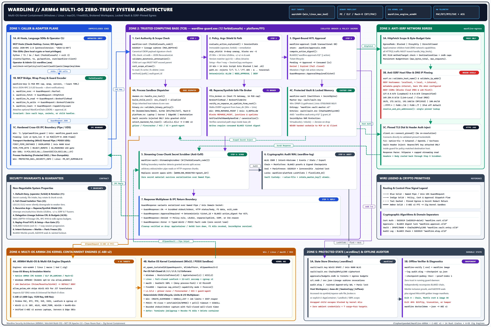

# Wardline (ARM64 / Cross-OS Edition)

> **Fail-closed capability boundary, host-sealed secret vault, anti-SSRF egress broker, OS-native ARM64 process sandbox, and tamper-evident audit ledger for autonomous agents across Windows on ARM (`0xAA64`), Linux `aarch64`, macOS Apple Silicon, and FreeBSD `arm64`.**

[-orange)](#architecture-summary)
[-f7a41d)](#cross-os-arm64-platform-matrix)
[](docs/CLI_AND_MCP.md#3-polyglot-client-sdks)

`Wardline-ARM64` provides first-class **ARM64 (`aarch64`) silicon-aware containment**: enforcing `StrictNative` ISA preflight (`PE 0xAA64`, `ELF EM_AARCH64`, `Mach-O ARM64`), blocking silent x64 emulation fallbacks (**Windows Prism**, **Rosetta 2**, **QEMU/FEX**) unless explicitly enabled, inspecting PAC/BTI/MTE/SVE hardware capabilities and OS page sizes (`4 KiB`/`16 KiB`/`64 KiB`), and protecting local credentials and audit trails across ARM64 laptops, cloud servers, and edge SBCs.

---

## System Architecture Diagram



*(Vector source: [`assets/architecture-arm64.svg`](assets/architecture-arm64.svg))*

---

## Architecture Summary

Wardline separates execution into three hard privilege zones:

1. **Zone 1 — Untrusted Caller & Hardened IPC Boundary**:
   `wardline-mcp` (stateless MCP stdio JSON-RPC `2024-11-05` bridge + third-party `wrap` proxy, `#![forbid(unsafe_code)]`), `wardline` CLI (`#![forbid(unsafe_code)]`), and thin Python, TypeScript, Go, and Rust SDKs talk to `wardline-guard` over a mutually authenticated local pipe:
   - **Windows**: `\\.\pipe\wardline_guard` (`FILE_FLAG_FIRST_PIPE_INSTANCE | PIPE_REJECT_REMOTE_CLIENTS`, user + SYSTEM SDDL).
   - **Linux / macOS / FreeBSD**: `0600` Unix Domain Socket verifying `SO_PEERCRED` / `LOCAL_PEERCRED` peer UID equality.
2. **Zone 2 — Trusted Computing Base (`wardline-guard`)**:
   Enforces `[operator_forbid]` overrides first, evaluates TOML v1 policy (`[architecture].mode`, `[session]` one-way `Setup -> Run`, recursive `argv_shield` wrapper unwrapping, `Allow` / `NeedApproval` / `Deny`), checks offline Ed25519 `WardCert` delegation chains + `lineage` subtree CRLs, gates mutating actions behind single-use `redb` HITL approvals, injects credentials inside `wardline-egress` via single-lookup DNS pinning + cross-chunk secret scrubbing + durable `redb` byte/request budgets, and records `ActionIntent` -> `ActionOutcome` in a locked `BLAKE3` + `Ed25519` `.wlog` WAL with RFC-6962 binary Merkle proofs and irreversible `.tainted` panic freeze.
   Of the **14 workspace crates**, **12 enforce `#![forbid(unsafe_code)]`** (plus standalone `#![forbid(unsafe_code)]` `wardline-client`, 13 total); OS FFI and Zig FFI are quarantined solely inside `wardline-platform` and `wardline-sandbox`.
3. **Zone 3 — ARM64 OS Kernel Containment (`Zig C-ABI v2`, `L0`–`L2`)**:
   Strict fail-closed tier selection (`select_backend_for_tier` never downgrades) spawning `wardline-guest-agent` or native ARM64 executables inside OS kernel containment across Windows ARM64, Linux `aarch64`, Apple Silicon macOS, and FreeBSD ARM64 (`L0`, `L1`, `L1.5`, `L2`).

---

## Cross-OS ARM64 Platform Matrix

| Target | Static Zig Engine (`zig build all-engines`) | L1 Default Kernel Containment | L1.5 Hardened Profile | L2 Hypervisor Readiness (Staged / Fail-Closed) |
|---|---|---|---|---|
| **Windows ARM64** (`win-arm64`) | `zig-out/win-arm64/wardline_engine_arm64.lib` | PE `0xAA64` preflight + zero-network `AppContainer` + Hardened `JobObject` + IOCP + `HANDLE_LIST` | Adds `Win32kSystemCallDisable` + `BlockNonMicrosoftBinaries` | Hyper-V HCS / ARM64 WHPX + signed golden image (`l2_hcs`) |
| **Linux ARM64** (`linux-arm64`) | `zig-out/linux-arm64/libwardline_engine_arm64.a` | `EM_AARCH64` + PAC/BTI notes + `unshare(NEWUSER\|NEWNET\|NEWIPC\|NEWUTS)` + fail-closed Landlock LSM + `AUDIT_ARCH_AARCH64` `seccomp-bpf` + `cgroup v2` | Rootless zero-NIC `gVisor` `runsc` (`l15_gvisor`) | KVM (`/dev/kvm`) + Firecracker REST/vsock zero-NIC pool (`l2_firecracker`) |
| **macOS ARM64** (`macos-arm64`) | `zig-out/macos-arm64/libwardline_engine_arm64.a` | `ARM64` Mach-O/Fat preflight + Seatbelt (`sandbox_init` SBPL) network disabled | Seatbelt + `(deny process-fork)` | Apple `Virtualization.framework` virtio-vsock (`l2_vz`) |
| **FreeBSD ARM64** (`freebsd-arm64`) | `zig-out/freebsd-arm64/libwardline_engine_arm64.a` | `EM_AARCH64` ELF + `rlimit` + closed FDs + Capsicum `cap_enter()` capability mode | Strict syscall/process lockdown | FreeBSD `bhyve` probe |

---

## Quick Start

```powershell
# 1. Build all 4 ARM64 Zig containment engines and run Zig C-ABI unit tests
zig build all-engines
zig build common-tests
zig build test

# 2. Cross-compile & Clippy-lint all 14 workspace crates for Windows ARM64 (0xAA64 PE)
cargo clippy --target aarch64-pc-windows-gnullvm --workspace -- -D warnings
cargo build --target aarch64-pc-windows-gnullvm --release --bins

# 3. On native ARM64 hosts (Windows ARM64 / Linux aarch64 / Apple Silicon):
cargo test --workspace -- --test-threads=1
cargo build --release --bins
wardline doctor --json
wardline demo --json
```

*(See [`Wardline-x64`](https://github.com/Elephantpanda6/Wardline-x64) for matching x86_64 builds.)*

---

## Documentation Index

- [`docs/ARCHITECTURE.md`](docs/ARCHITECTURE.md) — 14-crate workspace breakdown, `C-ABI v2` struct contracts, and trust boundaries
- [`docs/PLATFORMS_AND_USECASES.md`](docs/PLATFORMS_AND_USECASES.md) — Multi-OS & multi-arch matrix, ARM64 hardware extensions, and deployment use cases
- [`docs/POLICY.md`](docs/POLICY.md) — Declarative TOML v1 policy schema, `[architecture].mode`, `[operator_forbid]`, `[session]`, and `argv_shield`
- [`docs/CLI_AND_MCP.md`](docs/CLI_AND_MCP.md) — 5 release binaries, full CLI reference, `mcp serve`/`wrap`/`servers`, and Python/TS/Go/Rust SDKs
- [`docs/THREAT_MODEL.md`](docs/THREAT_MODEL.md) — Threat actors, `I1`–`I7` security invariants, and structural mitigations
- [`docs/GUIDE.md`](docs/GUIDE.md) — Prerequisites, native/ARM64 cross compilation, operator runbook, and `cargo-fuzz` targets
- [`docs/REVIEW.md`](docs/REVIEW.md) — Independent architecture & security review summary
- [`docs/VULNERABILITY_REPORT.md`](docs/VULNERABILITY_REPORT.md) — Hardening ledger (`WL-001`–`WL-008`)
- [`docs/TEST_RESULTS.md`](docs/TEST_RESULTS.md) — Exact ARM64 cross-compile, Zig C-ABI v2, and host test verification evidence
