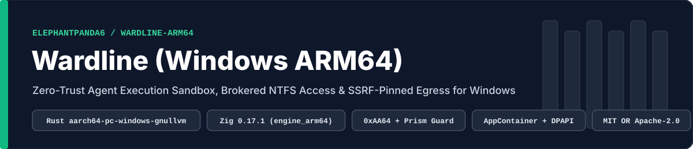

<div align="center">
  
</div>

<p align="center">
  <strong>Clean-Room Zero-Trust Capability Broker, Kernel Process Sandbox &amp; Anti-SSRF Egress Runtime for Windows on ARM64</strong>
</p>

<p align="center">
  <a href="docs/ARCHITECTURE.md"></a>
  <a href="docs/ARCHITECTURE.md"></a>
  <a href="docs/POLICY.md"></a>
  <a href="docs/THREAT_MODEL.md"></a>
  <a href="LICENSE-MIT"></a>
</p>

---

**Wardline (`win-arm64`)** is the dedicated **Windows on ARM64 (`aarch64-pc-windows-gnullvm`)** edition of the Wardline zero-trust agent capability broker and process sandbox. It brings full parity for brokered NTFS file access, DPAPI + `ChaCha20Poly1305` secret custody, SSRF-pinned HTTPS egress, and L0/L1 Win32 process containment while adding ARM64-specific controls for **`0xAA64` native binaries, `0xA641` ARM64EC opt-in, default-deny Prism `0x8664` emulation gating with conditional ACG suppression, hardware PAC/BTI telemetry, and zero-MinGW Zig cross-compilation wrappers (`tools/wl-arm64-*.cmd`)**.

> [!IMPORTANT]
> Looking for the Windows x64 edition (`x86_64-pc-windows-msvc` + CET Shadow Stack `engine_x64.zig`)? See the sibling repository [`Elephantpanda6/Wardline-x64`](https://github.com/Elephantpanda6/Wardline-x64).

---

## System Architecture (`win-arm64`)

<p align="center">
  <a href="assets/architecture-arm64.png">
    
  </a>
</p>

<p align="center">
  <sub>Rendered at <strong>4800×3200</strong> from clean vector source: <a href="assets/architecture-arm64.png">architecture-arm64.png</a> • <a href="assets/architecture-arm64.svg">architecture-arm64.svg (lossless SVG)</a> • <a href="docs/ARCHITECTURE.md">Full Architectural Walkthrough →</a></sub>
</p>

---

## ARM64 Multi-ISA & Prism Policy Matrix (`evaluateArm64SpawnPolicy`)

Windows on ARM64 can encounter three PE machine types. `engine_arm64.zig` enforces strict preflight classification before calling `CreateProcessW`:

| Child PE Machine | Constant | Default `mode = "strict_native"` | `mode = "allow_arm64ec"` | `mode = "allow_prism_x64"` | ACG (`PROHIBIT_DYNAMIC_CODE`) |
| :--- | :--- | :--- | :--- | :--- | :--- |
| **`0xAA64` (ARM64 Native)** | `IMAGE_FILE_MACHINE_ARM64` | **Allow** | **Allow** | **Allow** | **Enabled** (when `acg = true`) |
| **`0xA641` (ARM64EC)** | `IMAGE_FILE_MACHINE_ARM64EC` | **Deny** (`WL_ERR_PE_DISALLOWED_ARCH`) | **Allow** | **Allow (Native ABI)** | **Enabled** (when `acg = true`) |
| **`0x8664` (x64 via Prism)** | `IMAGE_FILE_MACHINE_AMD64` | **Deny** (`WL_ERR_PRISM_BLOCKED`) | **Deny** | **Allow** (`emulation = true`) | **Suppressed** (avoids Prism JIT `STATUS_DYNAMIC_CODE_BLOCKED`) |
| **`0x014C` / Script / Non-PE** | `I386` / Raw | **Deny** (`WL_ERR_PE_DISALLOWED_ARCH`) | **Deny** | **Deny** | N/A |

---

## Key Capabilities

- **Zero-Trust Asymmetric Delegation (`wardline-cert`)**: Ed25519 signature chains over canonical CBOR (`"wardline.cert.v1\0"`) supporting `arch = "arm64"` constraints, monotonic attenuation, and `crl.redb` revocation.
- **Hardened Single-Instance Guard (`wardline-guard.exe`)**: `FILE_FLAG_FIRST_PIPE_INSTANCE | PIPE_REJECT_REMOTE_CLIENTS` on `\\.\pipe\wardline_guard`, protected SDDL `D:P(A;OICI;GA;;;{UserSID})(A;OICI;GA;;;SY)`, and process DACL hardening (`PROTECTED_DACL_SECURITY_INFORMATION`).
- **Reparse-Safe NTFS File Broker (`file_broker.rs`)**: Segment-by-segment traversal with `FILE_FLAG_OPEN_REPARSE_POINT | FILE_FLAG_BACKUP_SEMANTICS`, rejecting junctions/symlinks (`FILE_ATTRIBUTE_REPARSE_POINT`), checking `GetFinalPathNameByHandleW(VOLUME_NAME_DOS)`, and requiring consumed `BLAKE3` write approvals.
- **DPAPI Vault & Streaming Redaction (`wardline-vault`)**: `CryptProtectData` master key + `ChaCha20Poly1305` secrets, `VirtualLock` + `Zeroize` RAM hygiene, and cross-chunk `[WARDLINE_REDACTED:<grant_id>]` scrubbing.
- **Anti-SSRF Pinned Egress (`wardline-egress`)**: Single-lookup DNS IP pinning + Windows Schannel TLS, blocking `169.254.0.0/16` IMDS, RFC1918, loopback, `::ffff:`, `localhost`/`.local`/`.internal`, and IPv6 by default.
- **Tamper-Evident Audit WAL (`wardline-log` + `wardline-verify.exe`)**: `WLG1` binary log with `LockFileEx` + `BLAKE3` hash chaining + `Ed25519` checkpoints.
- **Self-Contained Zig ARM64 Cross-Build**: [`tools/wl-arm64-cc.cmd`](tools/wl-arm64-cc.cmd) & [`tools/wl-arm64-link.cmd`](tools/wl-arm64-link.cmd) drive `zig cc -target aarch64-windows-gnu` automatically via [`.cargo/config.toml`](.cargo/config.toml) — no external MinGW-LLVM sysroot needed.

---

## Quickstart (`aarch64-pc-windows-gnullvm`)

### Prerequisites

- **Rust toolchain** with `aarch64-pc-windows-gnullvm` target (`rustup target add aarch64-pc-windows-gnullvm`)
- **Zig `0.17.1`** on `PATH` (or WinGet packages directory)
- **Python 3** (used by `tools/wl-arm64-{cc,link}.{cmd,py}` wrappers)

### Build, Cross-Verify & Inspect

```powershell
# 1. Build Zig ARM64 kernel sandbox engine (runs native tests on ARM64; cross-compiles tests on x64 hosts)
zig build
zig build test

# 2. Lint & compile stripped ARM64 release binaries (PE machine 0xAA64)
cargo clippy --workspace --all-targets -- -D warnings
cargo build --release --bins

# 3. On native Windows on ARM64 hardware (or windows-11-arm CI runner):
cargo test --workspace -- --test-threads=1
.\target\aarch64-pc-windows-gnullvm\release\wardline.exe doctor --json
```

---

## Documentation Suite

- **[Operator & Developer Guide](docs/GUIDE.md)** — ARM64 cross/native builds via Zig wrappers, `doctor --json` PAC/BTI inspection, Prism policy authoring, vault/cert/HITL workflows, and MCP integration.
- **[System Architecture Deep Dive](docs/ARCHITECTURE.md)** — 5-zone design, C-ABI v1 contract, `engine_arm64.zig` multi-ISA decision engine, conditional ACG suppression under Prism, and Zig cross-linker architecture.
- **[Threat Model & Security Analysis](docs/THREAT_MODEL.md)** — Adversary matrix, Prism JIT vs ACG trade-off analysis, NTFS junction/SSRF/LOLBin defenses, and staged `L2` MicroVM boundaries.
- **[Policy Manifest & WardCert Reference](docs/POLICY.md)** — Full `schemas/wardline.v1.toml` specification including `strict_native`, `allow_arm64ec`, and `allow_prism_x64`.
- **[CLI, MCP, Named Pipe IPC & SDK Reference](docs/CLI_AND_MCP.md)** — Complete flags for all 4 `0xAA64` binaries, MCP `2024-11-05` tools, pipe framing, and Python/TypeScript SDKs.
- **[Verification & Test Report (`win-arm64`)](docs/TEST_RESULTS.md)** — Cross-compilation build checks, PE `0xAA64` binary verification, Zig engine tests, and native `windows-11-arm` CI matrix.
- **[Security Policy](.github/SECURITY.md)** • **[Contributing Guide](CONTRIBUTING.md)** • **[Changelog](CHANGELOG.md)**

---

## License

Dual-licensed under **[MIT](LICENSE-MIT)** OR **[Apache-2.0](LICENSE-APACHE)** at your option.
