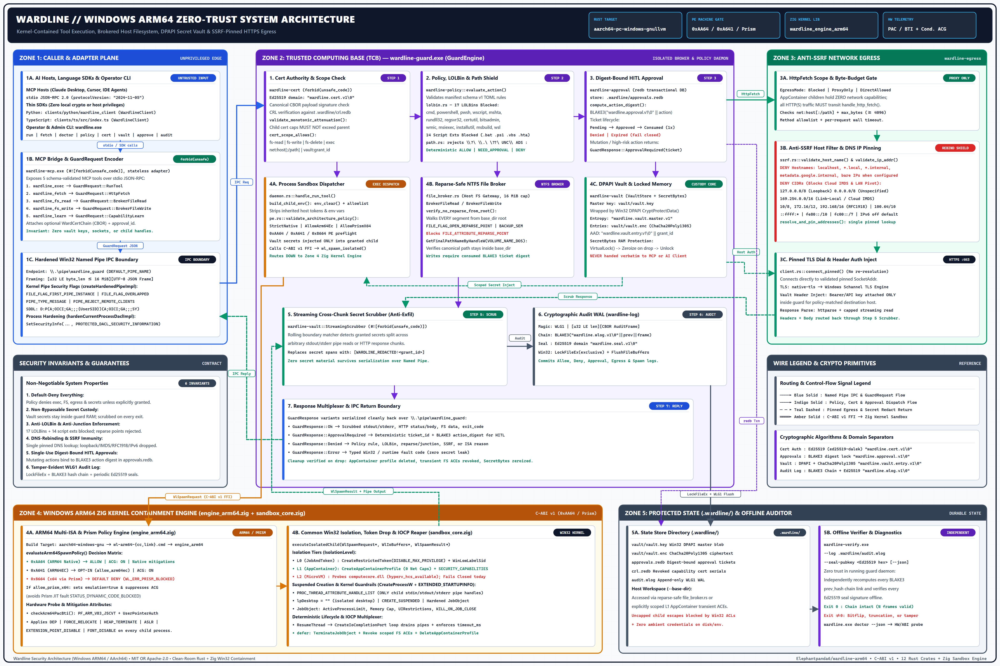

# Wardline (`win-arm64`) — System Architecture Specification

Deep architectural reference for **Wardline (`win-arm64`)**, targeting `aarch64-pc-windows-gnullvm` + Zig `0.17.1` (`aarch64-windows-gnu`).

  

> Lossless vector source: [`assets/architecture-arm64.svg`](../assets/architecture-arm64.svg) (`3600×2400` SVG) • Ultra-HD raster: [`assets/architecture-arm64.png`](../assets/architecture-arm64.png) (`4800×3200` PNG).

---

## 1. Five-Zone Architecture Overview

Wardline's control plane (Zones 1, 2, 3, and 5) enforces identical zero-trust boundaries across architectures, while Zone 4 swaps in [`platforms/win-arm64/engine_arm64.zig`](../platforms/win-arm64/engine_arm64.zig) (`wardline_engine_arm64`) plus [`tools/wl-arm64-{cc,link}.{cmd,py}`](../tools/wl-arm64-link.py) toolchain integration.

- **Zone 1 (Caller & Protocol Adapter Plane)**: Hosts `wardline.exe`, `WardlineClient` (Python/TypeScript), and `#![forbid(unsafe_code)]` `wardline-mcp.exe` (`2024-11-05`) forwarding requests over length-prefixed `[u32 LE <= 16 MiB][JSON]` Named Pipe IPC (`\\.\pipe\wardline_guard`).
- **Zone 2 (`wardline-guard.exe` TCB)**: Runs Ed25519 `WardCertChain` + `crl.redb` checks → policy / 25 LOLBins / 19 scripts / namespace, drive-relative & ADS shields → `approvals.redb` payload-bound `BLAKE3` ticket verification → dispatch to Zone 4 (`wl_spawn_isolated`), `file_broker.rs` (reparse-safe NTFS), or DPAPI/`ChaCha20Poly1305` `wardline-vault` → `StreamingScrubber` → `LockFileEx` `WLG1` audit WAL.
- **Zone 3 (`wardline-egress`)**: Enforces `Blocked | ProxyOnly | DirectAllowed`, host/IP blocklists (`localhost`, `.local`, `.internal`, `metadata.google.internal`, loopback, RFC1918, `169.254.0.0/16` IMDS, `100.64.0.0/10`, `::ffff:`, IPv6 off by default), single-lookup DNS pinning (`resolve_and_pin_addresses`), Windows Schannel TLS (`connect_pinned`), and post-response scrubbing.
- **Zone 4 (`engine_arm64.zig` + `sandbox_core.zig`)**: Multi-ISA preflight (`0xAA64` / `0xA641` / `0x8664` Prism), hardware PAC/BTI telemetry (`checkArm64PacBti()`), Win32 process mitigations (`word0`), L0 Restricted Token / L1 zero-network AppContainer creation (`CREATE_SUSPENDED`, `lpDesktop = ""`, `PROC_THREAD_ATTRIBUTE_HANDLE_LIST`), `JobObject` + IOCP reaping, and deferred cleanup. *(L2 probes `computecore.dll` and fails closed today.)*
- **Zone 5 (`.wardline/` & `wardline-verify.exe`)**: Durable vault, approvals, CRL, chained `audit.wlog`, and standalone offline cryptographic verification.

---

## 2. ARM64 Kernel Engine Internals (`engine_arm64.zig`)

### Multi-ISA Decision Function: `evaluateArm64SpawnPolicy()`

Before invoking `sandbox.executeIsolatedChild()`, `wl_spawn_isolated` classifies the target PE on disk via `inspectExecutablePeOnDisk()` and feeds it to `evaluateArm64SpawnPolicy(pe_class, allow_arm64ec, allow_prism_x64, req_acg)`:

| `WlPeClass` | Condition | Resulting `WlStatusCode` | `emulation` | `apply_acg` | Rationale |
| :--- | :--- | :--- | :---: | :---: | :--- |
| `.arm64` (`0xAA64`) | Always | `ok` (`0`) | `false` | `req_acg` | Native AArch64 instruction stream; supports strict ACG (`MITIGATION_PROHIBIT_DYNAMIC_CODE_ALWAYS_ON`). |
| `.arm64ec` (`0xA641`) | `allow_arm64ec == true` | `ok` (`0`) | `false` | `req_acg` | ABI-compatible hybrid ARM64EC module allowed by explicit opt-in. |
| `.arm64ec` (`0xA641`) | `allow_arm64ec == false` | `pe_disallowed_arch` (`4`) | `false` | `false` | Rejected under strict native policy. |
| `.amd64` (`0x8664`) | `allow_prism_x64 == true` | `ok` (`0`) | **`true`** | **`false`** | Permitted under Prism emulation; ACG is intentionally suppressed to prevent Prism JIT faults (`STATUS_DYNAMIC_CODE_BLOCKED`), and telemetry marks `emulation_detected = 1`. |
| `.amd64` (`0x8664`) | `allow_prism_x64 == false` | `prism_blocked` (`5`, `WL_ERR_PRISM_BLOCKED`) | `true` | `false` | Default-deny prevents transparent emulation bypasses. |
| `.x86` / `.script_or_raw` / `.unknown` | Always | `pe_disallowed_arch` (`4`) | `false` | `false` | Blocks 32-bit x86 and raw scripts outright. |

### ARM64 Process Mitigation Mask (`word0`)

Applied on every isolated ARM64 child (`engine_arm64.zig` lines 140–151):
- `MITIGATION_DEP_ENABLE`
- `MITIGATION_FORCE_RELOCATE_IMAGES_ALWAYS_ON`
- `MITIGATION_HEAP_TERMINATE_ALWAYS_ON`
- `MITIGATION_BOTTOM_UP_ASLR_ALWAYS_ON`
- `MITIGATION_HIGH_ENTROPY_ASLR_ALWAYS_ON`
- `MITIGATION_EXTENSION_POINT_DISABLE_ALWAYS_ON`
- `MITIGATION_FONT_DISABLE_ALWAYS_ON`
- `MITIGATION_PROHIBIT_DYNAMIC_CODE_ALWAYS_ON` *(only when `eval.apply_acg == true`)*

*(Note: `MITIGATION_SEHOP_ENABLE` is specific to x86/x64 SEH chains and is omitted on ARM64; hardware PAC/BTI support is probed via `checkArm64PacBti()` using `PF_ARM_V83_JSCVT_INSTRUCTIONS_AVAILABLE` and `ProcessUserPointerAuthPolicy`.)*

---

## 3. Zig Toolchain Integration (`tools/wl-arm64-*.cmd`)

Rust's Tier-2/Tier-3 `aarch64-pc-windows-gnullvm` target normally expects external `llvm-mingw` tools on Windows. `wardline-arm64` eliminates external MinGW requirements cleanly using [`tools/wl-arm64-cc.py`](../tools/wl-arm64-cc.py) and [`tools/wl-arm64-link.py`](../tools/wl-arm64-link.py):
- Compiles C dependencies via `zig cc -target aarch64-windows-gnu`.
- Rewrites `@*.rsp` linker response files and direct flags:
  - Removes `-nolibc` / `-nostartfiles` where needed by Zig's driver
  - Inserts `-lunwind` before dynamic objects
  - Maps `-lmsvcrt` → `-lucrtbase` and `-lsynchronization` → `-lapi-ms-win-core-synch-l1-2-0`
  - Brackets `-lwindows.*` import crates cleanly with `-Wl,-Bstatic ... -Wl,-Bdynamic`
- Produces compliant `0xAA64` (`IMAGE_FILE_MACHINE_ARM64`) Windows executables without relying on MSVC x64 cross-linkers for GNU Rust codegen.

---

## 4. C-ABI v1 Interface & `unsafe` Boundary

Identical C-ABI v1 contract (`wardline_abi.h`) and Rust `#![forbid(unsafe_code)]` split as `win-x64`: pure Rust across policy, certs, approvals, SSRF, MCP, offline verification, CLI, scrubbing, and guard orchestration; localized `windows-sys` FFI in `dpapi.rs`, `acl.rs`, `lock.rs`, `file_broker.rs`, `pipe_server.rs`, and `wardline-sandbox/src/lib.rs`; Zig native Win32 containment in `sandbox_core.zig` and `engine_arm64.zig`.
